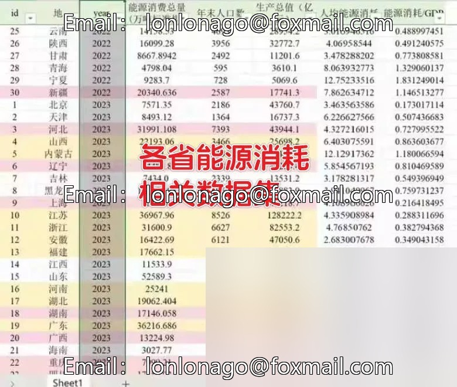
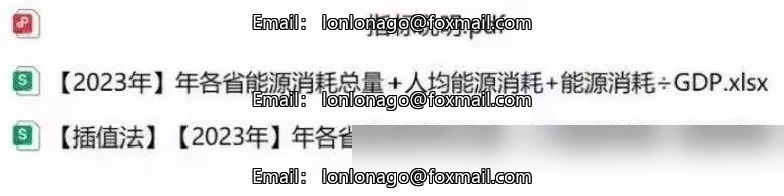

# Total energy consumption by provinces + per capita energy consumption + energy consumption/GDP (tons of standard coal per unit GDP)

## Body

Total energy consumption by provinces and regions + per capita energy consumption + energy consumption / GDP (tons standard coal / ten thousand yuan)

Time span: 2000-2023
Data description: Data from 2000-2019 comes from the *China Energy Statistical Yearbook*.
Data after 2020 has discontinued updating the Yearbook, so data is supplemented based on provincial yearbooks.
Do not doubt it; we will never sell counterfeit products.
There are no Tibetan data.

Version 1: Some provinces have data gaps that cannot be filled by the annual atlas (hard defects across the whole network)
Version 2: The linear interpolation method is used to fill the gaps.

web-based shipment, can be directly photographed and shipped.

The dataset covers provincial energy consumption totals, per-capita energy consumption and the ratio of energy consumption to GDP, spanning from 2000 to 2023 with missing values filled using linear interpolation.

<!-- AI_ENRICHED -->

## Images

## Payment

Here is a pay link on Stripe ( https://buy.stripe.com/3cs8yP7sY87d0vu9AB ). Please contact me lonlonago@foxmail.com after funding $89, and I will send you a complete data files , thank you!

